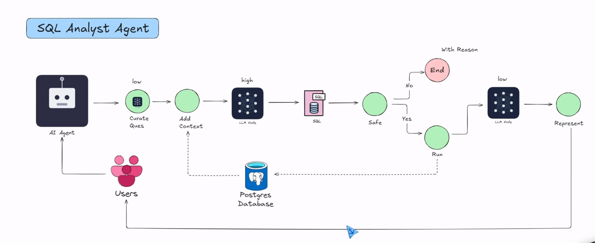
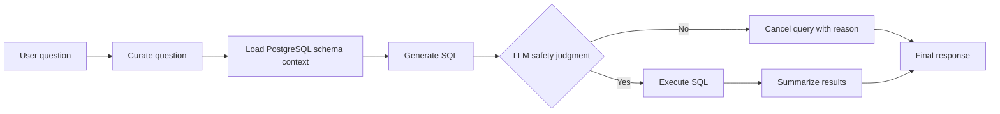
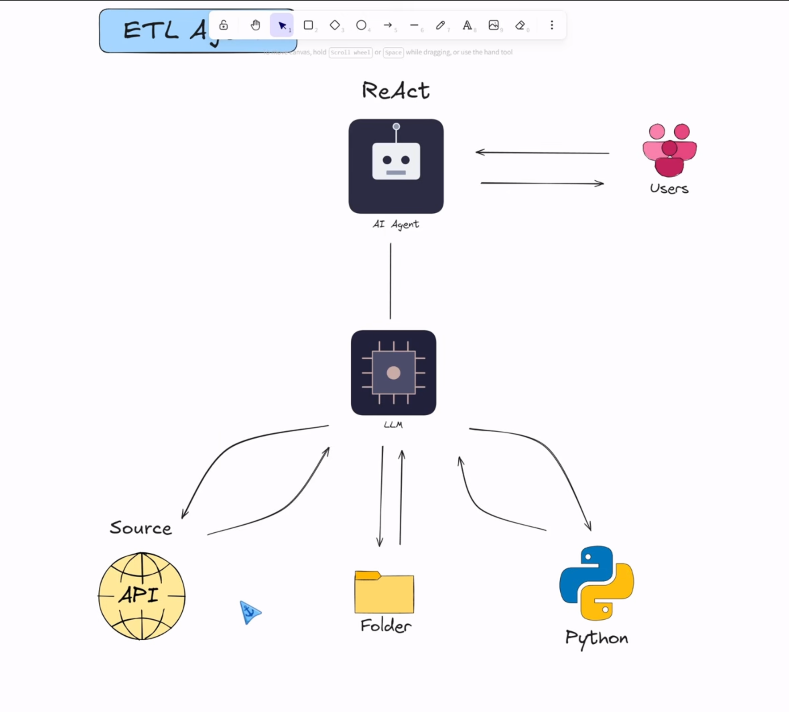

# Agentic Data Engineer

An agentic data engineering prototype that turns natural-language questions into governed analytics workflows. The repository currently contains an early **SQL Analyst** built with LangGraph; an **ETL Analyst** is planned and will use a ReAct (reason, act, observe) architecture.

> **Project status:** Active prototype, not production-ready. The SQL workflow is represented as a compiled graph, but end-to-end invocation and several state-field integrations still need completion. The ETL agent is not implemented yet.

## Why this project

Data teams routinely move between source systems, databases, and business questions. This project explores how specialized agents can make those workflows more accessible while keeping important decisions explicit: what context an agent uses, what tools it may call, and where execution must be gated.

The current focus is a natural-language-to-SQL workflow over PostgreSQL. The next planned capability is tool-using ETL, where an agent can inspect source data, choose and run transformations, and verify the resulting dataset.

## Current SQL Analyst Workflow



The SQL Analyst is modeled as a directed LangGraph workflow:



The implementation-level graph is shown below:


The implemented graph in `agents/sql_analyst.py` defines these stages:

- **Question curation:** rewrites the user request before query generation.
- **Schema grounding:** reads table and column metadata, plus a small sample of rows, from the PostgreSQL `public` schema.
- **SQL generation:** asks an LLM to produce PostgreSQL SQL and requests a default limit of 10 rows.
- **Execution gate:** asks a structured-output LLM judge whether the query appears read-only; a rejection follows a cancellation path.
- **Answer synthesis:** converts returned rows into a concise natural-language response.

This gate is an LLM judgment, not a security boundary. It must not be treated as a substitute for database permissions or deterministic SQL validation.

## Planned ETL Analyst

The ETL Analyst is work in progress. Its intended control loop follows ReAct: reason about the next step, call a bounded tool, inspect the observation, and decide whether to continue, retry, or stop.

The planned workflow is to discover and profile a source, propose a transformation, execute approved ETL tools, validate data quality, and report what changed. This is an architectural direction, not a capability available in the current code. `agents/etl_analyst.py` and `utils/etl_tools.py` are currently placeholders.

The diagram below captures the intended ReAct interaction between the agent, model, users, and candidate source types; it is a design reference, not a shipped workflow.



## Technology

- Python 3.13+
- LangGraph for explicit workflow orchestration
- LangChain and LangChain OpenAI integration for model calls
- Pydantic for structured state and safety-judge output
- PostgreSQL via psycopg2
- `uv` for dependency and environment management

## Repository Layout

```text
.
├── agents/
│   ├── sql_analyst.py   # SQL Analyst graph and node functions
│   ├── etl_analyst.py   # Planned ReAct ETL agent (placeholder)
│   └── scratch.py       # Scratch work
├── models/
│   └── schema.py        # Agent state and judge response models
├── utils/
│   ├── database.py      # PostgreSQL schema inspection and query execution
│   ├── feed_db.py       # CSV-to-PostgreSQL sample loader
│   ├── llm_pick.py      # LLM selection
│   └── etl_tools.py     # Planned ETL tools (placeholder)
├── sources/             # Reserved for source connectors
├── main.py              # Current bootstrap entry point
└── pyproject.toml
```

## Getting Started

### Prerequisites

- Python 3.13 or later
- [`uv`](https://docs.astral.sh/uv/)
- A PostgreSQL database with tables in the `public` schema
- An OpenAI API key and access to the model identifiers configured in `utils/llm_pick.py`

### Install dependencies

```bash
uv sync
```

### Configure local environment

Create a `.env` file in the project root. Do not commit credentials.

```dotenv
OPENAI_API_KEY=your_api_key
host=localhost
port=5432
user=postgres
password=your_local_password
database=your_database
```

The SQL Analyst currently expects a reachable PostgreSQL instance and uses these database settings to inspect schema and execute queries. The model names are selected in `utils/llm_pick.py` and may need to be changed to models available to your account.

### Data setup

No sample CSV data is included in the repository. `utils/feed_db.py` expects `data/users.csv`, `data/vehicles.csv`, `data/rides.csv`, `data/payments.csv`, and `data/ratings.csv`.

**Caution:** the loader currently truncates its target tables before loading. Do not run it against data you need to preserve. Review the script and use a disposable local database until that behavior is made opt-in.

## Running the Project

There is not yet a supported command that accepts a user question and invokes the SQL Analyst graph. `main.py` currently prints a bootstrap message; the graph module defines and compiles the workflow but still needs a stable invocation interface and state initialization before it can serve as an end-to-end demo.

## Engineering Status and Next Steps

This repository is intentionally presented as an evolving engineering project. The next steps are:

1. Complete the SQL Analyst state contract and connect graph invocation to a CLI or API.
2. Add deterministic, fail-closed SQL validation and enforce read-only access with a least-privilege database role.
3. Improve database connection lifecycle, error propagation, and query result handling.
4. Implement the ETL Analyst as a ReAct loop with bounded tools, explicit observations, and stop conditions.
5. Add tests for graph routing, SQL policy cases, and ETL transformation and data-quality behavior.
6. Add structured logging, configuration validation, and operational documentation.

## Design Principles

- **Explicit control flow:** model agent stages and decision points as graph nodes and edges.
- **Grounded generation:** provide database schema context instead of asking the model to guess table structure.
- **Bounded actions:** keep tool access visible and constrain execution with policy and infrastructure controls.
- **Observable decisions:** retain clear stage boundaries so behavior can be tested and debugged.
- **Honest capability boundaries:** distinguish implemented workflows from planned agent behavior.